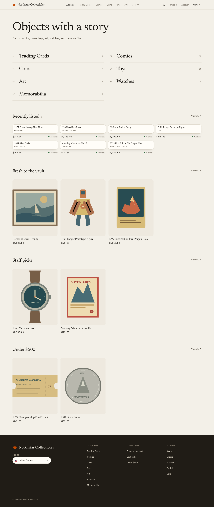
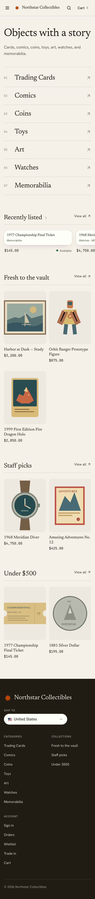
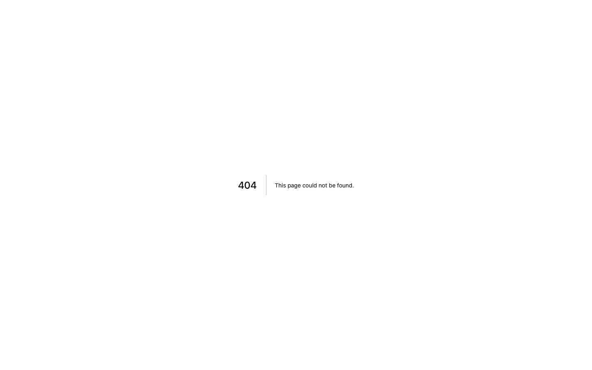

# Black-page stock book: collectibles storefront redesign, 2026-10-25

Live: https://openfront-collectibles-production.up.railway.app/us  
Commits (master, auto-deployed on Railway): 58a1276, 35a0412, cca8638, 92b2cf0, 0fc88d8  
Brief: `~/Code/Euler/state/briefs/design-skills-redesign-2026-10-25.md` (Openfront Batch 3, storefront only)

## The world
The storefront is a collector's stock book: black album pages, paper-white ink, each specimen held in a clear glassine strip on a black well, the cover's cloth in the store's logo hue for the header band, home cover, slab band and footer, and gilt from the same hue as the one accent. Rokkitt (slab) sets titles, stamped labels, numbers and prices; Literata sets everything read.

Owner bar applied: dark, considered and premium; no grey washed-out ground; no generic SaaS cards; no gradient or glow; UI copy is labels, states and errors only; phone width works. Tessier (dark editorial poster, objects floating on near-black, one display voice used sparingly) was the reference.

## What changed (presentation only; every route, state and workflow kept)
- Home: a cloth cover with the store's own title stamped large, Browse all items and Trade in, and the categories as thumb-index tabs flush to the cover's edge at stepped widths; recently listed entries as single records; collection rails of pocketed specimens.
- Every product tile and the product gallery: the specimen inset in a 4:3 glassine pocket and lifting inside it on hover.
- Route titles in Rokkitt; labels above headings removed; square 2px corners and gilt chosen pills on every control; text no smaller than 13px; Stripe card fields set in light ink so they stay readable on the dark page.
- All 7 categories and 3 collections are reachable from the nav, the cover index, the filters and the footer; no product, category or collection was dropped.

Routes captured: /us, /us/store, /us/categories/[...], /us/collections/[handle], /us/products/[handle], /us/cart, /us/account, /us/trade-in, /us/search (checkout and order confirmation share the same tokens and shell).

## Skills used, and how
- **Impeccable** (pbakaus): `impeccable context` loaded project state; `init` wrote `PRODUCT.md` (facts inferred from the repo and the brief, marked as inferred, because the brief ordered no approval stage); `concept-seed --scope direction --mode persuade` rolled the direction against my own ranked list of seven grounded candidates (the roll picked which one to build; challengers were weighed and their disciplines raised into the contract); the direction contract lives in `.impeccable/surfaces/features-storefront.md`; `reference/craft-floor.md` set the build floor; the shipped **impeccable-finish-reviewer** ran a full review, then a verdict pass on the fixes; the **impeccable-documenter** wrote `DESIGN.md` and `.impeccable/design.json` from the shipped code. No image generation was available, so the build was code-led (no comps) and the decision page was skipped (the brief said not to stop for approval).
- **design-taste-frontend** (Leon, tasteskill v2): `draw.mjs` dealt three directions and the full sheet of the chosen one (composition, type system, section blueprints), with slots redrawn only for stated reasons (listed below); the house rules (no eyebrows above headings, no monospace, no tracked tiny capitals, no gradients or glass, no index numbers, two faces at most, 13px type floor) and `lint.mjs` as a gate (0 FAIL on the storefront; deliberate world rules are marked `taste-skill-ignore` with the reason).
- **emil-design-eng**: custom ease-out `cubic-bezier(0.23, 1, 0.32, 1)`, press feedback on every control, hover gated to `(hover: hover) and (pointer: fine)`, entrances from an already-visible default, motion under `prefers-reduced-motion`.
- **frontend-design**: the anti-default calibration (no cream plus serif, no neon on black, no SaaS card kit) and the rule of one bold move per page.
- **high-end-visual-design** and **minimalist-ui** were read; both are opt-in light styles that conflict with the owner's pinned dark direction, so only their restraint on copy and components was used.
- Not used: gpt-taste, creative-director, brand-extract, brandkit, color-expert, animate, prototype, break-ui, mobile-native, pick-ui-library, hallmark, apple-design, taste-design.

Taste-skill direction for this repo: page-is-the-object (the stock book is the page; specimens get a label strip like a print with its swing tag); dealt type (Rokkitt and Literata) adopted; the dealt palette was translated to the pinned dark with the store hue kept.

## Gates (final state)
- Typecheck: `tsc --noEmit -p .` through `heavy-exec.py`, child exit 0, 0 errors, after every batch.
- Parity: `python3 -I platform-parity-audit-2026-10-20/parity-check.py` exit 0, drift 0, missing 0, sidebar-branding ok, sidebar-structure ok, after every batch. Only storefront files changed; the shared dashboard shell and platform pages are untouched.
- Live CSS checked for selectors that exist only in the new stylesheet after each deploy (guards against the Railway stale-compile issue).
- Every route below returned 200 (or the intended 404) on the live site with no horizontal overflow at 1440 and 390.

## Finish review
- Round 1 (fresh impeccable-finish-reviewer): disposition **fix**, with a material-fix list. Every item was applied in one batch, typechecked, parity-checked, pushed and recaptured.
- Round 2 (verdict pass on the recaptures): the remaining partials and small regressions it named were fixed in a final batch. The Impeccable documenter then wrote `DESIGN.md` and `.impeccable/design.json` from the shipped code, and the drift it flagged was cleaned up in the last commit. Two rounds is Impeccable's budget for an unattended run, so no third review ran. The final state hasn't been reviewer-certified as **ship**.

## Open items
- Buckram cloth texture (named in the direction contract) is not rendered: there's no image generation here, and the open-collection search found no honestly licensed seamless book-cloth tile. The cover, header and footer are a flat cloth colour until a real scanned tile is supplied, or the owner drops the texture.
- The demo item artwork is repo SVG art with its own light ground; it is product content and was not edited.

## Before and after
Before: the live site at the start of this work. These shots are on the demo data that existed then; a separate session reset and re-seeded every demo store the same afternoon, so the store name and catalog differ from the after shots.

After (live, 1440 desktop and 390 phone, full page):

- [after-us-desktop.png](design/redesign-20261025/after-us-desktop.png)
- [after-us-phone.png](design/redesign-20261025/after-us-phone.png)
- [after-us_account-desktop.png](design/redesign-20261025/after-us_account-desktop.png)
- [after-us_account-phone.png](design/redesign-20261025/after-us_account-phone.png)
- [after-us_cart-desktop.png](design/redesign-20261025/after-us_cart-desktop.png)
- [after-us_cart-phone.png](design/redesign-20261025/after-us_cart-phone.png)
- [after-us_categories_trading_cards-desktop.png](design/redesign-20261025/after-us_categories_trading_cards-desktop.png)
- [after-us_categories_trading_cards-phone.png](design/redesign-20261025/after-us_categories_trading_cards-phone.png)
- [after-us_collections_fresh_to_the_vault-desktop.png](design/redesign-20261025/after-us_collections_fresh_to_the_vault-desktop.png)
- [after-us_collections_fresh_to_the_vault-phone.png](design/redesign-20261025/after-us_collections_fresh_to_the_vault-phone.png)
- [after-us_products_1977_championship_final_ticket-desktop.png](design/redesign-20261025/after-us_products_1977_championship_final_ticket-desktop.png)
- [after-us_products_1977_championship_final_ticket-phone.png](design/redesign-20261025/after-us_products_1977_championship_final_ticket-phone.png)
- [after-us_search-desktop.png](design/redesign-20261025/after-us_search-desktop.png)
- [after-us_search-phone.png](design/redesign-20261025/after-us_search-phone.png)
- [after-us_store-desktop.png](design/redesign-20261025/after-us_store-desktop.png)
- [after-us_store-phone.png](design/redesign-20261025/after-us_store-phone.png)
- [after-us_trade_in-desktop.png](design/redesign-20261025/after-us_trade_in-desktop.png)
- [after-us_trade_in-phone.png](design/redesign-20261025/after-us_trade_in-phone.png)

Product facts are in `PRODUCT.md`, the direction contract is in `.impeccable/surfaces/features-storefront.md`, and the recorded system is in `DESIGN.md`.
